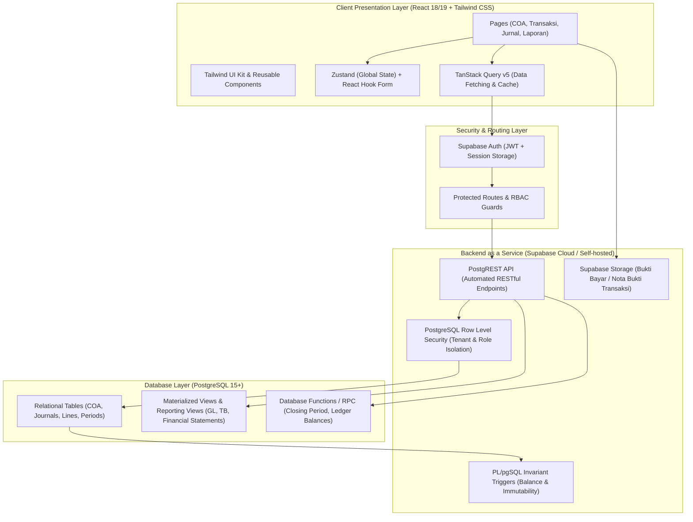
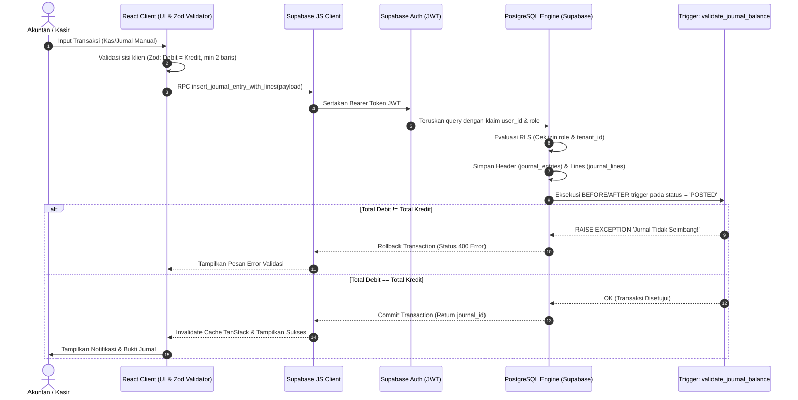
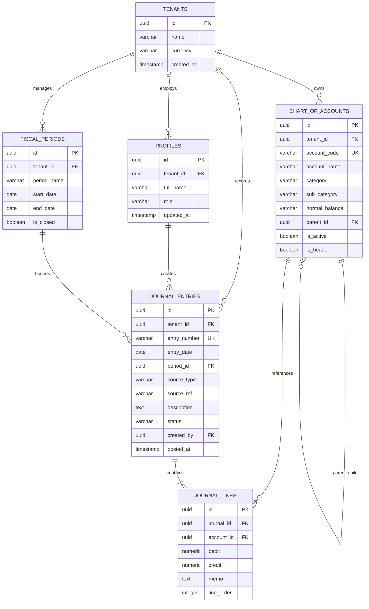

# SOFTWARE DEVELOPMENT LIFE CYCLE (SDLC) & SYSTEM ARCHITECTURE DOCUMENT
## Sistem Informasi Akuntansi Berbasis Web Khusus Perusahaan Dagang
**Tech Stack:** React, Tailwind CSS, Supabase (PostgreSQL)  
**Author:** Senior System Analyst & Software Architect  
**Version:** 1.0.0  
**Status:** Approved for Implementation  

---

## 1. PENDAHULUAN & METODOLOGI SDLC

### 1.1 Karakteristik Spesifik Akuntansi Perusahaan Dagang
Perusahaan dagang (*merchandising/trading company*) memiliki siklus akuntansi yang berbeda signifikan dibandingkan perusahaan jasa. Karakteristik utamanya meliputi:
1. **Perputaran Persediaan Barang Dagang (*Merchandise Inventory*)**: Transaksi pembelian barang untuk dijual kembali tanpa mengubah bentuk fisik.
2. **Kalkulasi Beban Pokok Penjualan (HPP / *Cost of Goods Sold*)**: Penentuan nilai persediaan yang terjual baik melalui metode perpetual maupun periodik.
3. **Akun Kontra dan Penyesuaian**: Akun seperti *Retur Penjualan*, *Potongan Penjualan*, *Retur Pembelian*, *Potongan Pembelian*, serta *Beban Angkut Pembelian (Freight-In)*.
4. **Struktur Laba Rugi Bertahap (*Multi-Step Income Statement*)**: Pemisahan tegas antara Laba Kotor (*Gross Profit*), Laba Operasional (*Operating Income*), dan Laba Bersih (*Net Income*).

### 1.2 Model SDLC: Agile Scrum
Pengembangan mengadopsi kerangka kerja **Agile Scrum** dengan sprint 2 mingguan:
- **Sprint 1 (Fondasi & COA)**: Setup Supabase, skema database, RLS, Auth, dan Bagan Akun (*Chart of Accounts*).
- **Sprint 2 (Engine Jurnal & Buku Besar)**: Core double-entry engine, trigger validasi debit-kredit, Jurnal Manual, Buku Besar.
- **Sprint 3 (Kas Masuk & Kas Keluar)**: Transaksi Kas/Bank otomatisasi pembuatan ayat jurnal penerimaan dan pengeluaran kas.
- **Sprint 4 (Laporan Keuangan)**: Neraca Saldo, Laba Rugi Multi-Step, Neraca (*Balance Sheet*).
- **Sprint 5 (Pengujian, Audit Trail, & Deployment)**: Uji konsistensi matematis, stress testing, UAT, dan deployment ke Vercel/Supabase.

---

## 2. ANALISIS KEBUTUHAN & CAKUPAN FITUR

### 2.1 Matriks Peran & Hak Akses (Role-Based Access Control / RBAC)
Sistem menggunakan 4 role pengguna:
| Fitur / Modul | Owner / Direktur | Akuntan (Senior) | Kasir / Staff Keuangan | Auditor |
| :--- | :---: | :---: | :---: | :---: |
| Kelola Akun & COA | Read | Full Access | Read | Read |
| Transaksi Kas Masuk | Read | Create, Read, Void | Create, Read | Read |
| Transaksi Kas Keluar | Approve, Read | Create, Read, Void | Create, Read | Read |
| Jurnal Manual & Penyesuaian | Read | Full Access | No Access | Read |
| Posting & Closing Periode | Approve | Execute | No Access | Read |
| Laporan Keuangan Lengkap | Full Access | Full Access | Restricted | Full Access |
| Audit Trail & Log | Read | Read | No Access | Full Access |

---

### 2.2 Dekomposisi Fitur

#### F01: Modul Autentikasi & Profil Pengguna
- **F01.1 Sign In / Sign Out**: Autentikasi berbasis email-password dan session JWT via Supabase Auth.
- **F01.2 RBAC Enforcement**: Validasi role di level middleware React Router dan PostgreSQL Row Level Security (RLS).
- **F01.3 Audit Profil**: Pencatatan data pengguna pembuat (*created_by*) dan penyetuju (*approved_by*) pada setiap transaksi.

#### F02: Bagan Akun (Chart of Accounts - COA)
- **F02.1 Standarisasi 5 Golongan Akun Utama**:
  - `1-0000` **Aset (Assets)**: Kas, Bank, Piutang Dagang, Cadangan Kerugian Piutang, Persediaan Barang Dagang, Perlengkapan, Aset Tetap, Akumulasi Penyusutan.
  - `2-0000` **Liabilitas (Liabilities)**: Utang Usaha, Beban yang Masih Harus Dibayar, Utang Bank Jangka Pendek, Utang Jangka Panjang.
  - `3-0000` **Ekuitas (Equity)**: Modal Disetor, Prive Pemilik, Laba Ditahan (*Retained Earnings*), Laba Periode Berjalan.
  - `4-0000` **Pendapatan (Revenue)**: Pendapatan Penjualan, Retur Penjualan, Potongan Penjualan, Pendapatan Non-Operasional.
  - `5-0000` **Beban Pokok Penjualan (HPP)**: Beban Pokok Penjualan, Pembelian, Beban Angkut Pembelian, Retur Pembelian, Potongan Pembelian.
  - `6-0000` **Beban Operasional (Expenses)**: Beban Gaji, Beban Sewa, Beban Listrik/Air/Internet, Beban Pemasaran, Beban Perlengkapan, Beban Penyusutan.
  - `8-0000` & `9-0000` **Pendapatan & Beban Lain-Lain**.
- **F02.2 Normal Balance & Leveling**: Penentuan saldo normal (`DEBIT` atau `KREDIT`) dan dukungan hierarki multi-tier (Header Akun vs Child/Detail Akun).

#### F03: Transaksi Kas Masuk (Cash Receipt / Inflow)
- **F03.1 Perekaman Bukti Kas Masuk (BKM)**: Form penerimaan kas/transfer bank untuk pelunasan piutang dagang, penjualan tunai, maupun penerimaan lainnya.
- **F03.2 Automatic Journal Generation**:
  - Pelunasan Piutang: `[Dr] Kas/Bank` & `[Cr] Piutang Dagang` (beserta potongan pelunasan jika ada).
  - Penjualan Kas: `[Dr] Kas/Bank` & `[Cr] Pendapatan Penjualan`.

#### F04: Transaksi Kas Keluar (Cash Disbursement / Outflow)
- **F04.1 Perekaman Bukti Kas Keluar (BKK)**: Form pengeluaran kas/transfer bank untuk pembayaran utang usaha, pembelian barang dagang tunai, beban operasional, dan prive pemilik.
- **F04.2 Automatic Journal Generation**:
  - Pembayaran Utang: `[Dr] Utang Usaha` & `[Cr] Kas/Bank` (beserta potongan pembayaran).
  - Pembayaran Beban: `[Dr] Beban Operasional Terkait` & `[Cr] Kas/Bank`.

#### F05: Jurnal Manual (General & Memorial Journal)
- **F05.1 Fleksibilitas Multi-Row**: Form dinamis untuk membuat ayat jurnal dengan minimal 2 baris (1 debit, 1 kredit) atau jurnal majemuk (*compound journal*).
- **F05.2 Validasi Zero-Sum (Balance Constraint)**: Sistem menolak penyimpanan atau posting jika `Total Debit != Total Kredit`.
- **F05.3 Jurnal Penyesuaian (AJP)**: Perekaman penyesuaian akhir periode (penyusutan aset, rekonsiliasi stok fisik/opname, persediaan akhir periodik).

#### F06: Modul Laporan Keuangan Komprehensif
- **F06.1 Buku Besar (General Ledger)**: Tampilan mutasi debet/kredit per akun beserta saldo berjalan (*running balance*) dan filter rentang tanggal.
- **F06.2 Neraca Saldo (Trial Balance)**: Ringkasan saldo akhir seluruh akun aktif untuk menguji keseimbangan debit dan kredit sebelum tutup buku.
- **F06.3 Laporan Laba Rugi Perusahaan Dagang (Income Statement)**: Format Multiple-Step yang menyajikan Penjualan Bersih, HPP, Laba Kotor, Beban Operasional, dan Laba Bersih.
- **F06.4 Neraca (Balance Sheet / Laporan Posisi Keuangan)**: Klasifikasi Aset, Liabilitas, dan Ekuitas dengan injeksi laba periode berjalan secara dinamis agar seimbang.
- **F06.5 Fitur Ekspor & Cetak**: Fitur cetak ramah printer (*print stylesheet*) dan ekspor ke PDF/Excel.

---

## 3. ARSITEKTUR SISTEM & ALUR DATA

### 3.1 Arsitektur Tingkat Tinggi (High-Level Architecture)



### 3.2 Alur Data Transaksi Double-Entry (Sequence Diagram)



---

## 4. SKEMA DATABASE RELASIONAL (DOUBLE-ENTRY ENGINE)

### 4.1 Diagram Relasi Entitas (Entity Relationship Diagram - ERD)



---

### 4.2 Script DDL PostgreSQL Produksi (Supabase Compatible)

Berikut skrip DDL lengkap mencakup ekstensi UUID, tipe enumerasi, tabel, indeks, validasi constraint, dan trigger PL/pgSQL:

```sql
-- ============================================================================
-- 1. EKSTENSI & ENUMERASI
-- ============================================================================
CREATE EXTENSION IF NOT EXISTS "uuid-ossp";

CREATE TYPE user_role AS ENUM ('owner', 'accountant', 'cashier', 'auditor');
CREATE TYPE account_category AS ENUM ('ASSET', 'LIABILITY', 'EQUITY', 'REVENUE', 'EXPENSE');
CREATE TYPE account_sub_category AS ENUM (
    'CURRENT_ASSET', 'FIXED_ASSET', 'OTHER_ASSET',
    'CURRENT_LIABILITY', 'LONG_TERM_LIABILITY',
    'OWNERS_EQUITY', 'RETAINED_EARNINGS',
    'OPERATING_REVENUE', 'SALES_CONTRA', 'NON_OPERATING_REVENUE',
    'COST_OF_GOODS_SOLD', 'OPERATING_EXPENSE', 'NON_OPERATING_EXPENSE'
);
CREATE TYPE normal_balance_type AS ENUM ('DEBIT', 'CREDIT');
CREATE TYPE journal_status AS ENUM ('DRAFT', 'POSTED', 'VOID');
CREATE TYPE source_type_enum AS ENUM ('CASH_IN', 'CASH_OUT', 'MANUAL_JOURNAL', 'SALES', 'PURCHASE', 'CLOSING');

-- ============================================================================
-- 2. TABEL PROFIL & TENANT
-- ============================================================================
CREATE TABLE tenants (
    id UUID PRIMARY KEY DEFAULT uuid_generate_v4(),
    company_name VARCHAR(150) NOT NULL,
    fiscal_year_start_month SMALLINT NOT NULL DEFAULT 1,
    currency VARCHAR(10) NOT NULL DEFAULT 'IDR',
    created_at TIMESTAMPTZ NOT NULL DEFAULT NOW()
);

CREATE TABLE profiles (
    id UUID PRIMARY KEY REFERENCES auth.users(id) ON DELETE CASCADE,
    tenant_id UUID NOT NULL REFERENCES tenants(id) ON DELETE CASCADE,
    full_name VARCHAR(100) NOT NULL,
    role user_role NOT NULL DEFAULT 'accountant',
    created_at TIMESTAMPTZ NOT NULL DEFAULT NOW(),
    updated_at TIMESTAMPTZ NOT NULL DEFAULT NOW()
);

-- ============================================================================
-- 3. TABEL BAGAN AKUN (CHART OF ACCOUNTS)
-- ============================================================================
CREATE TABLE chart_of_accounts (
    id UUID PRIMARY KEY DEFAULT uuid_generate_v4(),
    tenant_id UUID NOT NULL REFERENCES tenants(id) ON DELETE CASCADE,
    account_code VARCHAR(30) NOT NULL,
    account_name VARCHAR(150) NOT NULL,
    category account_category NOT NULL,
    sub_category account_sub_category NOT NULL,
    normal_balance normal_balance_type NOT NULL,
    parent_id UUID REFERENCES chart_of_accounts(id) ON DELETE RESTRICT,
    is_header BOOLEAN NOT NULL DEFAULT FALSE,
    is_active BOOLEAN NOT NULL DEFAULT TRUE,
    created_at TIMESTAMPTZ NOT NULL DEFAULT NOW(),
    CONSTRAINT uq_tenant_account_code UNIQUE (tenant_id, account_code)
);

CREATE INDEX idx_coa_tenant_cat ON chart_of_accounts(tenant_id, category);
CREATE INDEX idx_coa_parent ON chart_of_accounts(parent_id);

-- ============================================================================
-- 4. TABEL PERIODE FISKAL (FISCAL PERIODS)
-- ============================================================================
CREATE TABLE fiscal_periods (
    id UUID PRIMARY KEY DEFAULT uuid_generate_v4(),
    tenant_id UUID NOT NULL REFERENCES tenants(id) ON DELETE CASCADE,
    period_name VARCHAR(50) NOT NULL,
    start_date DATE NOT NULL,
    end_date DATE NOT NULL,
    is_closed BOOLEAN NOT NULL DEFAULT FALSE,
    closed_at TIMESTAMPTZ,
    closed_by UUID REFERENCES profiles(id),
    CONSTRAINT chk_period_dates CHECK (end_date >= start_date),
    CONSTRAINT uq_tenant_period UNIQUE (tenant_id, period_name)
);

-- ============================================================================
-- 5. TABEL JURNAL: HEADER & DETAIL (DOUBLE-ENTRY)
-- ============================================================================
CREATE TABLE journal_entries (
    id UUID PRIMARY KEY DEFAULT uuid_generate_v4(),
    tenant_id UUID NOT NULL REFERENCES tenants(id) ON DELETE CASCADE,
    period_id UUID REFERENCES fiscal_periods(id) ON DELETE RESTRICT,
    entry_number VARCHAR(50) NOT NULL,
    entry_date DATE NOT NULL DEFAULT CURRENT_DATE,
    description TEXT NOT NULL,
    source_type source_type_enum NOT NULL DEFAULT 'MANUAL_JOURNAL',
    source_ref VARCHAR(100),
    status journal_status NOT NULL DEFAULT 'POSTED',
    created_by UUID REFERENCES profiles(id) ON DELETE SET NULL,
    created_at TIMESTAMPTZ NOT NULL DEFAULT NOW(),
    posted_at TIMESTAMPTZ DEFAULT NOW(),
    CONSTRAINT uq_tenant_entry_number UNIQUE (tenant_id, entry_number)
);

CREATE INDEX idx_journal_tenant_date ON journal_entries(tenant_id, entry_date);
CREATE INDEX idx_journal_status ON journal_entries(tenant_id, status);

CREATE TABLE journal_lines (
    id UUID PRIMARY KEY DEFAULT uuid_generate_v4(),
    journal_id UUID NOT NULL REFERENCES journal_entries(id) ON DELETE CASCADE,
    account_id UUID NOT NULL REFERENCES chart_of_accounts(id) ON DELETE RESTRICT,
    debit NUMERIC(18, 4) NOT NULL DEFAULT 0.0000,
    credit NUMERIC(18, 4) NOT NULL DEFAULT 0.0000,
    memo TEXT,
    line_order INT NOT NULL DEFAULT 1,
    created_at TIMESTAMPTZ NOT NULL DEFAULT NOW(),
    CONSTRAINT chk_non_negative_amounts CHECK (debit >= 0 AND credit >= 0),
    CONSTRAINT chk_debit_xor_credit CHECK (
        (debit > 0 AND credit = 0) OR 
        (credit > 0 AND debit = 0)
    )
);

CREATE INDEX idx_jlines_journal ON journal_lines(journal_id);
CREATE INDEX idx_jlines_account ON journal_lines(account_id);

-- ============================================================================
-- 6. INTEGRITAS ATOMIK: TRIGGER VALIDASI BALANCE DEBIT = KREDIT
-- ============================================================================
CREATE OR REPLACE FUNCTION fn_validate_journal_balance()
RETURNS TRIGGER AS $$
DECLARE
    v_total_debit NUMERIC(18, 4);
    v_total_credit NUMERIC(18, 4);
    v_line_count INT;
    v_period_closed BOOLEAN;
BEGIN
    -- Validasi status POSTED saja yang wajib balanced
    IF NEW.status = 'POSTED' THEN
        -- 1. Cek apakah periode fiskal sedang ditutup (Closed)
        IF NEW.period_id IS NOT NULL THEN
            SELECT is_closed INTO v_period_closed FROM fiscal_periods WHERE id = NEW.period_id;
            IF v_period_closed THEN
                RAISE EXCEPTION 'Tidak dapat menyimpan atau memposting jurnal pada periode fiskal yang sudah ditutup.';
            END IF;
        END IF;

        -- 2. Cek baris jurnal dan perimbangan total debit vs total credit
        SELECT 
            COALESCE(SUM(debit), 0), 
            COALESCE(SUM(credit), 0),
            COUNT(*)
        INTO 
            v_total_debit, 
            v_total_credit,
            v_line_count
        FROM journal_lines
        WHERE journal_id = NEW.id;

        IF v_line_count < 2 THEN
            RAISE EXCEPTION 'Jurnal harus memiliki sekurang-kurangnya 2 baris (1 Debit dan 1 Kredit).';
        END IF;

        IF ROUND(v_total_debit, 2) <> ROUND(v_total_credit, 2) THEN
            RAISE EXCEPTION 'Jurnal TIDAK SEIMBANG! Total Debit (%) != Total Kredit (%). Selisih: %',
                v_total_debit, v_total_credit, ABS(v_total_debit - v_total_credit);
        END IF;
    END IF;

    RETURN NEW;
END;
$$ LANGUAGE plpgsql;

-- Constraint Trigger dieksekusi di akhir transaksi (DEFERRABLE INITIALLY DEFERRED)
CREATE CONSTRAINT TRIGGER trg_verify_journal_balance
AFTER INSERT OR UPDATE ON journal_entries
DEFERRABLE INITIALLY DEFERRED
FOR EACH ROW
EXECUTE FUNCTION fn_validate_journal_balance();

-- ============================================================================
-- 7. ATURAN ROW LEVEL SECURITY (RLS)
-- ============================================================================
ALTER TABLE tenants ENABLE ROW LEVEL SECURITY;
ALTER TABLE profiles ENABLE ROW LEVEL SECURITY;
ALTER TABLE chart_of_accounts ENABLE ROW LEVEL SECURITY;
ALTER TABLE fiscal_periods ENABLE ROW LEVEL SECURITY;
ALTER TABLE journal_entries ENABLE ROW LEVEL SECURITY;
ALTER TABLE journal_lines ENABLE ROW LEVEL SECURITY;

-- Helper function untuk mendapatkan tenant_id user saat ini
CREATE OR REPLACE FUNCTION get_auth_tenant_id()
RETURNS UUID AS $$
    SELECT tenant_id FROM profiles WHERE id = auth.uid();
$$ LANGUAGE sql STABLE SECURITY DEFINER;

-- Kebijakan RLS Isolasi Multi-Tenant
CREATE POLICY rls_tenant_isolation_coa ON chart_of_accounts
    FOR ALL USING (tenant_id = get_auth_tenant_id());

CREATE POLICY rls_tenant_isolation_periods ON fiscal_periods
    FOR ALL USING (tenant_id = get_auth_tenant_id());

CREATE POLICY rls_tenant_isolation_entries ON journal_entries
    FOR ALL USING (tenant_id = get_auth_tenant_id());

CREATE POLICY rls_tenant_isolation_lines ON journal_lines
    FOR ALL USING (
        EXISTS (
            SELECT 1 FROM journal_entries e 
            WHERE e.id = journal_lines.journal_id 
            AND e.tenant_id = get_auth_tenant_id()
        )
    );
```

---

## 5. LOGIKA KALKULASI MATEMATIS & ENGINE LAPORAN KEUANGAN

### 5.1 Landasan Matematis Double-Entry
Persamaan dasar akuntansi modern dinyatakan sebagai:
$$\text{Aset} + \text{Beban} + \text{Potongan Penjualan} = \text{Liabilitas} + \text{Ekuitas} + \text{Pendapatan} + \text{Potongan Pembelian}$$

Aturan pergerakan saldo akun:
| Golongan Akun | Saldo Normal | Penambahan (+) | Pengurangan (-) |
| :--- | :---: | :---: | :---: |
| **Aset (Assets)** | **DEBIT** | Debit | Kredit |
| **Liabilitas (Liabilities)** | **KREDIT** | Kredit | Debit |
| **Ekuitas (Equity)** | **KREDIT** | Kredit | Debit |
| **Pendapatan (Revenue)** | **KREDIT** | Kredit | Debit |
| **Beban Pokok Penjualan (HPP)** | **DEBIT** | Debit | Kredit |
| **Beban Operasional (Expense)** | **DEBIT** | Debit | Kredit |

---

### 5.2 Buku Besar (General Ledger)

#### A. Formulasi Saldo Berjalan (Running Balance)
Untuk akun bersaldo normal **DEBIT** (misal Kas, Piutang, Persediaan, Beban):
$$\text{Saldo Berjalan}_t = \text{Saldo Awal} + \sum_{i=1}^{t} (\text{Debit}_i - \text{Kredit}_i)$$

Untuk akun bersaldo normal **KREDIT** (misal Utang Usaha, Modal, Pendapatan):
$$\text{Saldo Berjalan}_t = \text{Saldo Awal} + \sum_{i=1}^{t} (\text{Kredit}_i - \text{Debit}_i)$$

#### B. Implementasi SQL Stored Procedure / View
```sql
CREATE OR REPLACE FUNCTION get_general_ledger(
    p_tenant_id UUID,
    p_account_id UUID,
    p_start_date DATE,
    p_end_date DATE
)
RETURNS TABLE (
    line_id UUID,
    entry_number VARCHAR,
    entry_date DATE,
    description TEXT,
    memo TEXT,
    debit NUMERIC,
    credit NUMERIC,
    normal_balance normal_balance_type,
    running_balance NUMERIC
) AS $$
DECLARE
    v_norm normal_balance_type;
    v_init_balance NUMERIC(18, 4) := 0;
BEGIN
    SELECT normal_balance INTO v_norm 
    FROM chart_of_accounts 
    WHERE id = p_account_id AND tenant_id = p_tenant_id;

    -- Hitung Saldo Awal sebelum p_start_date
    SELECT 
        CASE 
            WHEN v_norm = 'DEBIT' THEN COALESCE(SUM(jl.debit - jl.credit), 0)
            ELSE COALESCE(SUM(jl.credit - jl.debit), 0)
        END INTO v_init_balance
    FROM journal_lines jl
    JOIN journal_entries je ON jl.journal_id = je.id
    WHERE je.tenant_id = p_tenant_id 
      AND jl.account_id = p_account_id
      AND je.status = 'POSTED'
      AND je.entry_date < p_start_date;

    RETURN QUERY
    WITH movements AS (
        SELECT 
            jl.id AS line_id,
            je.entry_number,
            je.entry_date,
            je.description,
            jl.memo,
            jl.debit,
            jl.credit,
            v_norm AS normal_balance,
            CASE 
                WHEN v_norm = 'DEBIT' THEN (jl.debit - jl.credit)
                ELSE (jl.credit - jl.debit)
            END AS net_movement,
            je.created_at,
            jl.line_order
        FROM journal_lines jl
        JOIN journal_entries je ON jl.journal_id = je.id
        WHERE je.tenant_id = p_tenant_id 
          AND jl.account_id = p_account_id
          AND je.status = 'POSTED'
          AND je.entry_date BETWEEN p_start_date AND p_end_date
    )
    SELECT 
        m.line_id,
        m.entry_number,
        m.entry_date,
        m.description,
        m.memo,
        m.debit,
        m.credit,
        m.normal_balance,
        v_init_balance + SUM(m.net_movement) OVER (ORDER BY m.entry_date, m.created_at, m.line_order) AS running_balance
    FROM movements m
    ORDER BY m.entry_date, m.created_at, m.line_order;
END;
$$ LANGUAGE plpgsql STABLE SECURITY DEFINER;
```

---

### 5.3 Neraca Saldo (Trial Balance)

#### A. Formulasi Matematis
Pada Neraca Saldo, setiap akun dijumlahkan seluruh mutasi debit dan kreditnya dalam periode terpilih:
$$\text{Total Debit}_A = \sum \text{Debit}_A, \quad \text{Total Kredit}_A = \sum \text{Kredit}_A$$

Penentuan Posisi Saldo Akhir Berdasarkan Saldo Normal:
- Jika Saldo Normal Akun = `DEBIT`:
  $$\text{Net} = \text{Total Debit}_A - \text{Total Kredit}_A$$
  $$\text{Jika } \text{Net} \ge 0 \implies \text{Saldo Debit} = \text{Net}, \quad \text{Saldo Kredit} = 0$$
  $$\text{Jika } \text{Net} < 0 \implies \text{Saldo Debit} = 0, \quad \text{Saldo Kredit} = |\text{Net}|$$
- Jika Saldo Normal Akun = `KREDIT`:
  $$\text{Net} = \text{Total Kredit}_A - \text{Total Debit}_A$$
  $$\text{Jika } \text{Net} \ge 0 \implies \text{Saldo Debit} = 0, \quad \text{Saldo Kredit} = \text{Net}$$
  $$\text{Jika } \text{Net} < 0 \implies \text{Saldo Debit} = |\text{Net}|, \quad \text{Saldo Kredit} = 0$$

Syarat Mutlak Keseimbangan:
$$\sum \text{Saldo Debit Seluruh Akun} \equiv \sum \text{Saldo Kredit Seluruh Akun}$$

#### B. Implementasi SQL Stored Procedure
```sql
CREATE OR REPLACE FUNCTION get_trial_balance(
    p_tenant_id UUID,
    p_end_date DATE
)
RETURNS TABLE (
    account_id UUID,
    account_code VARCHAR,
    account_name VARCHAR,
    category account_category,
    sub_category account_sub_category,
    normal_balance normal_balance_type,
    ending_debit NUMERIC,
    ending_credit NUMERIC
) AS $$
BEGIN
    RETURN QUERY
    WITH raw_sums AS (
        SELECT 
            c.id AS acc_id,
            c.account_code AS code,
            c.account_name AS name,
            c.category AS cat,
            c.sub_category AS sub_cat,
            c.normal_balance AS norm,
            COALESCE(SUM(jl.debit), 0) AS total_d,
            COALESCE(SUM(jl.credit), 0) AS total_c
        FROM chart_of_accounts c
        LEFT JOIN journal_lines jl ON c.id = jl.account_id
        LEFT JOIN journal_entries je ON jl.journal_id = je.id AND je.status = 'POSTED' AND je.entry_date <= p_end_date
        WHERE c.tenant_id = p_tenant_id AND c.is_header = FALSE AND c.is_active = TRUE
        GROUP BY c.id, c.account_code, c.account_name, c.category, c.sub_category, c.normal_balance
    )
    SELECT 
        rs.acc_id,
        rs.code,
        rs.name,
        rs.cat,
        rs.sub_cat,
        rs.norm,
        CASE 
            WHEN rs.norm = 'DEBIT' AND (rs.total_d - rs.total_c) >= 0 THEN (rs.total_d - rs.total_c)
            WHEN rs.norm = 'KREDIT' AND (rs.total_c - rs.total_d) < 0 THEN ABS(rs.total_c - rs.total_d)
            ELSE 0
        END AS ending_debit,
        CASE 
            WHEN rs.norm = 'KREDIT' AND (rs.total_c - rs.total_d) >= 0 THEN (rs.total_c - rs.total_d)
            WHEN rs.norm = 'DEBIT' AND (rs.total_d - rs.total_c) < 0 THEN ABS(rs.total_d - rs.total_c)
            ELSE 0
        END AS ending_credit
    FROM raw_sums rs
    WHERE (rs.total_d > 0 OR rs.total_c > 0)
    ORDER BY rs.code ASC;
END;
$$ LANGUAGE plpgsql STABLE SECURITY DEFINER;
```

---

### 5.4 Laporan Laba Rugi Multi-Step Perusahaan Dagang

#### A. Algoritma Kalkulasi Khusus Dagang
Struktur Laba Rugi Perusahaan Dagang dihitung melalui 5 tahapan berantai:

1. **Penjualan Bersih (*Net Sales*)**:
   $$\text{Penjualan Bersih} = \text{Penjualan Kotor} - \text{Retur Penjualan} - \text{Potongan Penjualan}$$
   *(Catatan: Akun Retur & Potongan Penjualan berstatus Contra-Revenue bersaldo normal DEBIT).*

2. **Beban Pokok Penjualan (HPP / *Cost of Goods Sold*)**:
   - *Metode Perpetual*: Nilai akumulasi mutasi debit akun HPP yang terposting otomatis saat transaksi penjualan barang.
   - *Metode Periodik*:
     $$\text{Pembelian Bersih} = \text{Pembelian} + \text{Beban Angkut Pembelian} - \text{Retur Pembelian} - \text{Potongan Pembelian}$$
     $$\text{Barang Siap Dijual (BTUD)} = \text{Persediaan Barang Dagang Awal} + \text{Pembelian Bersih}$$
     $$\text{HPP} = \text{BTUD} - \text{Persediaan Barang Dagang Akhir}$$

3. **Laba Kotor (*Gross Profit*)**:
   $$\text{Laba Kotor} = \text{Penjualan Bersih} - \text{Beban Pokok Penjualan (HPP)}$$

4. **Laba Operasional (*Operating Income*)**:
   $$\text{Total Beban Operasi} = \sum \text{Beban Penjualan} + \sum \text{Beban Administrasi \& Umum}$$
   $$\text{Laba Operasional} = \text{Laba Kotor} - \text{Total Beban Operasi}$$

5. **Laba Bersih Sebelum & Setelah Pajak (*Net Profit*)**:
   $$\text{Pendapatan \& Beban Lain} = \sum \text{Pendapatan Non-Operasional} - \sum \text{Beban Non-Operasional}$$
   $$\text{Laba Bersih} = \text{Laba Operasional} + \text{Pendapatan \& Beban Lain}$$

#### B. Implementasi SQL Stored Procedure Laba Rugi
```sql
CREATE OR REPLACE FUNCTION get_income_statement(
    p_tenant_id UUID,
    p_start_date DATE,
    p_end_date DATE
)
RETURNS JSON AS $$
DECLARE
    v_gross_sales NUMERIC(18,4) := 0;
    v_sales_returns NUMERIC(18,4) := 0;
    v_sales_discounts NUMERIC(18,4) := 0;
    v_net_sales NUMERIC(18,4) := 0;
    
    v_cogs NUMERIC(18,4) := 0;
    v_gross_profit NUMERIC(18,4) := 0;
    
    v_operating_expenses NUMERIC(18,4) := 0;
    v_operating_income NUMERIC(18,4) := 0;
    
    v_other_revenue NUMERIC(18,4) := 0;
    v_other_expenses NUMERIC(18,4) := 0;
    v_net_income NUMERIC(18,4) := 0;
BEGIN
    -- 1. Penjualan Kotor (Kredit - Debit)
    SELECT COALESCE(SUM(jl.credit - jl.debit), 0) INTO v_gross_sales
    FROM journal_lines jl
    JOIN journal_entries je ON jl.journal_id = je.id
    JOIN chart_of_accounts coa ON jl.account_id = coa.id
    WHERE je.tenant_id = p_tenant_id AND je.status = 'POSTED'
      AND je.entry_date BETWEEN p_start_date AND p_end_date
      AND coa.sub_category = 'OPERATING_REVENUE';

    -- 2. Retur & Potongan Penjualan (Debit - Kredit)
    SELECT COALESCE(SUM(jl.debit - jl.credit), 0) INTO v_sales_returns
    FROM journal_lines jl
    JOIN journal_entries je ON jl.journal_id = je.id
    JOIN chart_of_accounts coa ON jl.account_id = coa.id
    WHERE je.tenant_id = p_tenant_id AND je.status = 'POSTED'
      AND je.entry_date BETWEEN p_start_date AND p_end_date
      AND coa.sub_category = 'SALES_CONTRA';

    v_net_sales := v_gross_sales - v_sales_returns;

    -- 3. HPP (Debit - Kredit)
    SELECT COALESCE(SUM(jl.debit - jl.credit), 0) INTO v_cogs
    FROM journal_lines jl
    JOIN journal_entries je ON jl.journal_id = je.id
    JOIN chart_of_accounts coa ON jl.account_id = coa.id
    WHERE je.tenant_id = p_tenant_id AND je.status = 'POSTED'
      AND je.entry_date BETWEEN p_start_date AND p_end_date
      AND coa.sub_category = 'COST_OF_GOODS_SOLD';

    v_gross_profit := v_net_sales - v_cogs;

    -- 4. Beban Operasional (Debit - Kredit)
    SELECT COALESCE(SUM(jl.debit - jl.credit), 0) INTO v_operating_expenses
    FROM journal_lines jl
    JOIN journal_entries je ON jl.journal_id = je.id
    JOIN chart_of_accounts coa ON jl.account_id = coa.id
    WHERE je.tenant_id = p_tenant_id AND je.status = 'POSTED'
      AND je.entry_date BETWEEN p_start_date AND p_end_date
      AND coa.sub_category = 'OPERATING_EXPENSE';

    v_operating_income := v_gross_profit - v_operating_expenses;

    -- 5. Non-Operasional
    SELECT COALESCE(SUM(jl.credit - jl.debit), 0) INTO v_other_revenue
    FROM journal_lines jl
    JOIN journal_entries je ON jl.journal_id = je.id
    JOIN chart_of_accounts coa ON jl.account_id = coa.id
    WHERE je.tenant_id = p_tenant_id AND je.status = 'POSTED'
      AND je.entry_date BETWEEN p_start_date AND p_end_date
      AND coa.sub_category = 'NON_OPERATING_REVENUE';

    SELECT COALESCE(SUM(jl.debit - jl.credit), 0) INTO v_other_expenses
    FROM journal_lines jl
    JOIN journal_entries je ON jl.journal_id = je.id
    JOIN chart_of_accounts coa ON jl.account_id = coa.id
    WHERE je.tenant_id = p_tenant_id AND je.status = 'POSTED'
      AND je.entry_date BETWEEN p_start_date AND p_end_date
      AND coa.sub_category = 'NON_OPERATING_EXPENSE';

    v_net_income := v_operating_income + (v_other_revenue - v_other_expenses);

    RETURN json_build_object(
        'gross_sales', v_gross_sales,
        'sales_contra', v_sales_returns,
        'net_sales', v_net_sales,
        'cogs', v_cogs,
        'gross_profit', v_gross_profit,
        'operating_expenses', v_operating_expenses,
        'operating_income', v_operating_income,
        'other_revenue', v_other_revenue,
        'other_expenses', v_other_expenses,
        'net_income', v_net_income
    );
END;
$$ LANGUAGE plpgsql STABLE SECURITY DEFINER;
```

---

### 5.5 Neraca (Balance Sheet / Laporan Posisi Keuangan)

#### A. Formulasi Keseimbangan Aktiva vs Pasiva
Persamaan penutup Neraca:
$$\text{Total Aset} = \text{Total Liabilitas} + \text{Total Ekuitas}$$

Di mana komponen Ekuitas diperluas dengan **Laba Periode Berjalan (*Current Year Earnings*)**:
$$\text{Total Ekuitas} = \text{Modal Disetor} - \text{Prive} + \text{Laba Ditahan Historis} + \text{Laba Bersih Berjalan}$$

Laba Bersih Berjalan diperoleh dari:
$$\text{Laba Bersih Berjalan} = \sum_{\text{awal tahun}}^{\text{tanggal neraca}} (\text{Pendapatan} - \text{HPP} - \text{Beban})$$

Tanpa penambahan Laba Bersih Berjalan ini ke pos Ekuitas, Neraca **tidak akan pernah seimbang (out of balance)** sebelum dilakukannya proses Tutup Buku Akhir Tahun (*Year-End Closing Journal*).

#### B. Implementasi SQL Stored Procedure Neraca
```sql
CREATE OR REPLACE FUNCTION get_balance_sheet(
    p_tenant_id UUID,
    p_as_of_date DATE
)
RETURNS JSON AS $$
DECLARE
    v_total_assets NUMERIC(18, 4) := 0;
    v_current_assets NUMERIC(18, 4) := 0;
    v_fixed_assets NUMERIC(18, 4) := 0;
    v_other_assets NUMERIC(18, 4) := 0;

    v_total_liabilities NUMERIC(18, 4) := 0;
    v_current_liabilities NUMERIC(18, 4) := 0;
    v_long_term_liabilities NUMERIC(18, 4) := 0;

    v_total_equity NUMERIC(18, 4) := 0;
    v_equity_accounts NUMERIC(18, 4) := 0;
    v_current_year_earnings NUMERIC(18, 4) := 0;
    
    v_year_start DATE;
BEGIN
    v_year_start := DATE_TRUNC('year', p_as_of_date)::DATE;

    -- 1. Hitung Pos ASET (Debit - Kredit)
    SELECT 
        COALESCE(SUM(CASE WHEN coa.sub_category = 'CURRENT_ASSET' THEN jl.debit - jl.credit ELSE 0 END), 0),
        COALESCE(SUM(CASE WHEN coa.sub_category = 'FIXED_ASSET' THEN jl.debit - jl.credit ELSE 0 END), 0),
        COALESCE(SUM(CASE WHEN coa.sub_category = 'OTHER_ASSET' THEN jl.debit - jl.credit ELSE 0 END), 0)
    INTO v_current_assets, v_fixed_assets, v_other_assets
    FROM journal_lines jl
    JOIN journal_entries je ON jl.journal_id = je.id
    JOIN chart_of_accounts coa ON jl.account_id = coa.id
    WHERE je.tenant_id = p_tenant_id AND je.status = 'POSTED'
      AND je.entry_date <= p_as_of_date
      AND coa.category = 'ASSET';

    v_total_assets := v_current_assets + v_fixed_assets + v_other_assets;

    -- 2. Hitung Pos LIABILITAS (Kredit - Debit)
    SELECT 
        COALESCE(SUM(CASE WHEN coa.sub_category = 'CURRENT_LIABILITY' THEN jl.credit - jl.debit ELSE 0 END), 0),
        COALESCE(SUM(CASE WHEN coa.sub_category = 'LONG_TERM_LIABILITY' THEN jl.credit - jl.debit ELSE 0 END), 0)
    INTO v_current_liabilities, v_long_term_liabilities
    FROM journal_lines jl
    JOIN journal_entries je ON jl.journal_id = je.id
    JOIN chart_of_accounts coa ON jl.account_id = coa.id
    WHERE je.tenant_id = p_tenant_id AND je.status = 'POSTED'
      AND je.entry_date <= p_as_of_date
      AND coa.category = 'LIABILITY';

    v_total_liabilities := v_current_liabilities + v_long_term_liabilities;

    -- 3. Hitung Pos EKUITAS DASAR (Kredit - Debit)
    SELECT COALESCE(SUM(jl.credit - jl.debit), 0)
    INTO v_equity_accounts
    FROM journal_lines jl
    JOIN journal_entries je ON jl.journal_id = je.id
    JOIN chart_of_accounts coa ON jl.account_id = coa.id
    WHERE je.tenant_id = p_tenant_id AND je.status = 'POSTED'
      AND je.entry_date <= p_as_of_date
      AND coa.category = 'EQUITY';

    -- 4. Hitung LABA PERIODE BERJALAN DARI AWAL TAHUN HINGGA p_as_of_date
    -- (Pendapatan [K-D] - HPP [D-K] - Beban [D-K])
    SELECT 
        COALESCE(SUM(
            CASE 
                WHEN coa.category = 'REVENUE' THEN (jl.credit - jl.debit)
                WHEN coa.category IN ('EXPENSE') OR coa.sub_category = 'COST_OF_GOODS_SOLD' THEN -(jl.debit - jl.credit)
                ELSE 0
            END
        ), 0)
    INTO v_current_year_earnings
    FROM journal_lines jl
    JOIN journal_entries je ON jl.journal_id = je.id
    JOIN chart_of_accounts coa ON jl.account_id = coa.id
    WHERE je.tenant_id = p_tenant_id AND je.status = 'POSTED'
      AND je.entry_date BETWEEN v_year_start AND p_as_of_date;

    v_total_equity := v_equity_accounts + v_current_year_earnings;

    RETURN json_build_object(
        'as_of_date', p_as_of_date,
        'assets', json_build_object(
            'current_assets', v_current_assets,
            'fixed_assets', v_fixed_assets,
            'other_assets', v_other_assets,
            'total_assets', v_total_assets
        ),
        'liabilities', json_build_object(
            'current_liabilities', v_current_liabilities,
            'long_term_liabilities', v_long_term_liabilities,
            'total_liabilities', v_total_liabilities
        ),
        'equity', json_build_object(
            'equity_accounts', v_equity_accounts,
            'current_year_earnings', v_current_year_earnings,
            'total_equity', v_total_equity
        ),
        'total_liabilities_and_equity', (v_total_liabilities + v_total_equity),
        'is_balanced', (ROUND(v_total_assets, 2) = ROUND(v_total_liabilities + v_total_equity, 2)),
        'difference', ABS(v_total_assets - (v_total_liabilities + v_total_equity))
    );
END;
$$ LANGUAGE plpgsql STABLE SECURITY DEFINER;
```

---

## 6. DESIGN PATTERN & ARSITEKTUR KODE FRONTEND (REACT & TAILWIND)

### 6.1 Struktur Direktori Proyek
```text
src/
├── assets/                  # Logo, icons, static assets
├── components/              # Reusable UI Atoms & Molecules
│   ├── ui/                  # Button, Modal, Input, Badge, Table, Alert
│   ├── layout/              # Sidebar, Topbar, AppShell, Breadcrumb
│   └── accounting/          # AccountPicker, CurrencyInput, BalanceBadge
├── context/                 # AuthContext & Supabase Session Provider
├── hooks/                   # Custom Hooks (useJournals, useLedger, useReports)
├── lib/                     # Supabase Client, Formatters, Math Helpers
│   ├── supabaseClient.ts    # Supabase Client Singleton
│   ├── formatters.ts        # IDR Currency & Date-fns Localized Formatter
│   └── accountingMath.ts    # Decimal arithmetic utilities
├── pages/                   # Application Views
│   ├── auth/                # Login, ForgotPassword
│   ├── dashboard/           # Financial KPI Summary & Charts
│   ├── coa/                 # Chart of Accounts Management Tree Table
│   ├── cash-in/             # Form & History Kas Masuk
│   ├── cash-out/            # Form & History Kas Keluar
│   ├── journal/             # Jurnal Manual, Form Dynamic Lines, Post/Void
│   └── reports/             # Buku Besar, Neraca Saldo, Laba Rugi, Neraca
├── services/                # Supabase API services (TanStack Query definitions)
├── types/                   # TypeScript interfaces (COA, Journal, Report types)
└── App.tsx                  # React Router v6 Routes & Providers
```

### 6.2 Contoh Implementasi Form Jurnal Manual Dinamis (React + React Hook Form + Tailwind CSS)
Komponen ini menjamin validasi sisi klien bahwa baris jurnal minimal 2 dan total debit sama dengan total kredit sebelum diposting ke Supabase:

```tsx
// src/components/accounting/ManualJournalForm.tsx
import React, { useState, useEffect } from 'react';
import { useForm, useFieldArray } from 'react-hook-form';
import { supabase } from '../../lib/supabaseClient';

interface JournalLineForm {
  account_id: string;
  debit: number;
  credit: number;
  memo: string;
}

interface JournalFormValues {
  entry_date: string;
  description: string;
  lines: JournalLineForm[];
}

export const ManualJournalForm: React.FC = () => {
  const { register, control, handleSubmit, watch, formState: { errors } } = useForm<JournalFormValues>({
    defaultValues: {
      entry_date: new Date().toISOString().split('T')[0],
      description: '',
      lines: [
        { account_id: '', debit: 0, credit: 0, memo: '' },
        { account_id: '', debit: 0, credit: 0, memo: '' }
      ]
    }
  });

  const { fields, append, remove } = useFieldArray({
    control,
    name: 'lines'
  });

  const watchedLines = watch('lines');
  const [totalDebit, setTotalDebit] = useState(0);
  const [totalCredit, setTotalCredit] = useState(0);
  const [isBalanced, setIsBalanced] = useState(true);

  useEffect(() => {
    const d = watchedLines.reduce((acc, curr) => acc + (Number(curr.debit) || 0), 0);
    const c = watchedLines.reduce((acc, curr) => acc + (Number(curr.credit) || 0), 0);
    setTotalDebit(d);
    setTotalCredit(c);
    setIsBalanced(Math.abs(d - c) < 0.001 && d > 0);
  }, [watchedLines]);

  const onSubmit = async (data: JournalFormValues) => {
    if (!isBalanced) {
      alert('Total Debit dan Total Kredit harus seimbang!');
      return;
    }

    try {
      // Panggil Stored Procedure / RPC di Supabase untuk eksekusi atomik
      const { error } = await supabase.rpc('post_manual_journal', {
        p_entry_date: data.entry_date,
        p_description: data.description,
        p_lines: data.lines
      });

      if (error) throw error;
      alert('Jurnal berhasil dibukukan secara double-entry!');
    } catch (err: any) {
      alert('Gagal memposting jurnal: ' + err.message);
    }
  };

  return (
    <div className="bg-white rounded-xl shadow-lg border border-slate-200 p-6 max-w-5xl mx-auto">
      <div className="border-b border-slate-200 pb-4 mb-6 flex justify-between items-center">
        <div>
          <h2 className="text-2xl font-bold text-slate-800">Entri Jurnal Umum (Memorial)</h2>
          <p className="text-sm text-slate-500">Menerapkan prinsip Double-Entry Bookkeeping yang ketat</p>
        </div>
        <div className={`px-4 py-2 rounded-full font-semibold text-sm ${isBalanced ? 'bg-emerald-100 text-emerald-800' : 'bg-rose-100 text-rose-800 animate-pulse'}`}>
          {isBalanced ? '✓ Seimbang (Balanced)' : `✕ Belum Seimbang (Selisih: Rp ${Math.abs(totalDebit - totalCredit).toLocaleString('id-ID')})`}
        </div>
      </div>

      <form onSubmit={handleSubmit(onSubmit)} className="space-y-6">
        <div className="grid grid-cols-1 md:grid-cols-2 gap-4">
          <div>
            <label className="block text-sm font-medium text-slate-700 mb-1">Tanggal Transaksi</label>
            <input 
              type="date" 
              {...register('entry_date', { required: true })} 
              className="w-full px-3 py-2 border rounded-lg focus:ring-2 focus:ring-indigo-500 border-slate-300"
            />
          </div>
          <div>
            <label className="block text-sm font-medium text-slate-700 mb-1">Keterangan / Deskripsi Transaksi</label>
            <input 
              type="text" 
              placeholder="Contoh: Penyesuaian persediaan barang dagang akhir periode" 
              {...register('description', { required: true })} 
              className="w-full px-3 py-2 border rounded-lg focus:ring-2 focus:ring-indigo-500 border-slate-300"
            />
          </div>
        </div>

        {/* Tabel Baris Jurnal */}
        <div className="overflow-x-auto border border-slate-200 rounded-lg">
          <table className="w-full text-left text-sm">
            <thead className="bg-slate-50 text-slate-600 border-b border-slate-200">
              <tr>
                <th className="p-3">Akun</th>
                <th className="p-3">Memo / Catatan</th>
                <th className="p-3 w-40 text-right">Debit (Rp)</th>
                <th className="p-3 w-40 text-right">Kredit (Rp)</th>
                <th className="p-3 w-16 text-center">Aksi</th>
              </tr>
            </thead>
            <tbody className="divide-y divide-slate-100">
              {fields.map((field, index) => (
                <tr key={field.id} className="hover:bg-slate-50/50">
                  <td className="p-2">
                    <input 
                      placeholder="Kode / Akun ID" 
                      {...register(`lines.${index}.account_id` as const, { required: true })}
                      className="w-full px-2 py-1.5 border rounded border-slate-300 text-sm"
                    />
                  </td>
                  <td className="p-2">
                    <input 
                      placeholder="Keterangan baris" 
                      {...register(`lines.${index}.memo` as const)}
                      className="w-full px-2 py-1.5 border rounded border-slate-300 text-sm"
                    />
                  </td>
                  <td className="p-2">
                    <input 
                      type="number" 
                      step="any"
                      placeholder="0" 
                      {...register(`lines.${index}.debit` as const, { valueAsNumber: true })}
                      className="w-full px-2 py-1.5 border rounded border-slate-300 text-right text-sm font-mono"
                    />
                  </td>
                  <td className="p-2">
                    <input 
                      type="number" 
                      step="any"
                      placeholder="0" 
                      {...register(`lines.${index}.credit` as const, { valueAsNumber: true })}
                      className="w-full px-2 py-1.5 border rounded border-slate-300 text-right text-sm font-mono"
                    />
                  </td>
                  <td className="p-2 text-center">
                    {fields.length > 2 && (
                      <button 
                        type="button" 
                        onClick={() => remove(index)} 
                        className="text-rose-500 hover:text-rose-700 font-bold p-1"
                      >
                        ✕
                      </button>
                    )}
                  </td>
                </tr>
              ))}
            </tbody>
            <tfoot className="bg-slate-50 font-semibold border-t border-slate-200">
              <tr>
                <td colSpan={2} className="p-3 text-right">Total:</td>
                <td className="p-3 text-right font-mono text-indigo-700">Rp {totalDebit.toLocaleString('id-ID')}</td>
                <td className="p-3 text-right font-mono text-indigo-700">Rp {totalCredit.toLocaleString('id-ID')}</td>
                <td></td>
              </tr>
            </tfoot>
          </table>
        </div>

        <div className="flex justify-between items-center pt-2">
          <button 
            type="button" 
            onClick={() => append({ account_id: '', debit: 0, credit: 0, memo: '' })}
            className="px-4 py-2 border border-slate-300 text-slate-700 rounded-lg hover:bg-slate-50 font-medium text-sm transition"
          >
            + Tambah Baris
          </button>
          <button 
            type="submit" 
            disabled={!isBalanced} 
            className="px-6 py-2.5 bg-indigo-600 text-white font-semibold rounded-lg hover:bg-indigo-700 disabled:opacity-50 disabled:cursor-not-allowed shadow-md transition"
          >
            Posting Jurnal Sekarang
          </button>
        </div>
      </form>
    </div>
  );
};
```

---

## 7. RENCANA PENGUJIAN & JAMINAN KUALITAS (QA TESTING PLAN)

### 7.1 Test Case Konsistensi Matematis (Double-Entry Invariant Test)
| ID Test | Skenario Uji | Prosedur | Hasil yang Diharapkan |
| :--- | :--- | :--- | :--- |
| **TC-01** | Unbalanced Journal Insertion | Input baris Debit: 1.000.000, Kredit: 800.000 | PostgreSQL trigger melempar exception `Jurnal TIDAK SEIMBANG!` dan transaksi dibatalkan (Rollback). |
| **TC-02** | Zero Rows / Single Line | Hanya menginput 1 baris jurnal | Ditolak oleh trigger: minimal 2 baris. |
| **TC-03** | Negative Debit or Credit | Input nominal bertanda minus (-50.000) | Ditolak oleh constraint `chk_non_negative_amounts`. |
| **TC-04** | Simultaneous Debit & Credit | Baris yang sama diisi Debit: 50.000 dan Kredit: 50.000 | Ditolak oleh constraint `chk_debit_xor_credit`. |
| **TC-05** | Closed Fiscal Period Posting | Memposting transaksi pada tanggal periode yang `is_closed = TRUE` | Ditolak oleh trigger `fn_validate_journal_balance`. |
| **TC-06** | Trial Balance Zero Sum | Melakukan query `get_trial_balance()` | $\sum \text{Debit} = \sum \text{Kredit}$. |
| **TC-07** | Balance Sheet Proof | Memanggil `get_balance_sheet()` | Total Aset = Total Liabilitas + Total Ekuitas (termasuk Laba Periode Berjalan). Indikator `is_balanced = TRUE`. |

---

## 8. DEPLOYMENT, BACKUP & PEMELIHARAAN

1. **Frontend Hosting**: Vercel atau Cloudflare Pages dengan konfigurasi continuous deployment dari branch `main` GitHub.
2. **Backend & Database**: Supabase Hosted Pro Instance dengan Automated Daily Backup & Point-in-time Recovery (PITR).
3. **Environment Security**: Penyimpanan `SUPABASE_URL` dan `SUPABASE_ANON_KEY` pada `.env.local` dan secrets manager; tidak pernah mengekspos `SUPABASE_SERVICE_ROLE_KEY` ke sisi frontend.
4. **Disaster Recovery**: Skrip export schema dan data periodik secara terenkripsi.

---
Dokumentasi ini telah diverifikasi dan siap dijadikan acuan utama implementasi teknis.
